

  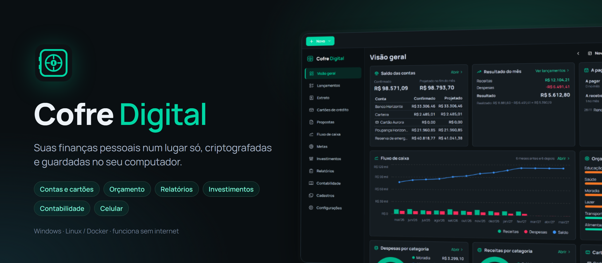

  
  
  
  
  
  

  <a href="../../releases/latest"><b>⬇️ Baixar a versão mais nova</b></a> ·
  <a href="#funcionalidades">Funcionalidades</a> ·
  <a href="#fotos">Fotos</a> ·
  <a href="#instalar">Instalar</a> ·
  <a href="#segurança-e-atualizações">Segurança</a>

O **Cofre Digital** é um controle financeiro pessoal e familiar completo que roda **no seu computador**: contas, cartões e faturas, orçamento, relatórios, investimentos e até contabilidade. Abre no navegador do PC e no celular, funciona sem internet e guarda tudo criptografado na sua máquina, ou no seu próprio servidor.

<table>
  <tr>
    <td width="33%" valign="top">
      <h3>🔒 Privado</h3>
      Seus dados ficam com você, criptografados, no PC ou no seu servidor. Sem cadastro em site, sem anúncios e sem mensalidade de nuvem. Funciona offline.
    </td>
    <td width="33%" valign="top">
      <h3>🧭 Completo</h3>
      Do lançamento do dia a dia ao balanço patrimonial: cartões com faturas e parcelas, importação de extratos, orçamento, metas, 20 relatórios e investimentos com IR.
    </td>
    <td width="33%" valign="top">
      <h3>📱 Em qualquer lugar</h3>
      Use no PC e no celular, como app instalável, pela rede de casa. Ou coloque numa VPS atrás da Cloudflare e acesse de onde estiver, com a família.
    </td>
  </tr>
</table>

## Funcionalidades

| Recurso | O que faz |
|---|---|
| 💳 **Contas e cartões** | Conta corrente, poupança, dinheiro e investimentos; cartões de crédito com faturas, fechamento, parcelas futuras, antecipação, limite e cartões físicos. |
| 🧾 **Lançamentos** | Receitas, despesas e transferências; parcelados e recorrentes; comprovantes anexados (cifrados); busca avançada e filtros salvos. |
| 🏦 **Importação** | Extratos OFX, CSV, QIF e planilhas (XLSX, XLS, ODS), com conciliação automática e regras de preenchimento. Desfaz a importação inteira se precisar. |
| 🔄 **Migrar do Meu Dinheiro** | Traz anos de histórico do Meu Dinheiro Web (contas, cartões, faturas, categorias, contatos e lançamentos) e confere o saldo de cada conta. |
| 📊 **Painel e relatórios** | Visão geral personalizável e 20 relatórios: fluxo de caixa, categorias, contas a pagar e a receber, DRE, balanço, evolução do patrimônio, previsão de saldo e mais. Imprime e exporta. |
| 🎯 **Orçamento e metas** | Orçamento por categoria e por centro de custo, metas de economia e fechamento de posição depois de conferir com o banco. |
| 📈 **Investimentos** | Ativos, compras e vendas, proventos, desdobramentos, carteira com preço médio e rentabilidade, e o IR mensal de renda variável. |
| 📚 **Contabilidade e impostos** | Plano de contas, balancete, DRE e balanço contábeis; Carnê-Leão; propostas para clientes que viram receita quando aceitas. |
| 👨‍👩‍👧 **Para a família** | Vários usuários, com acesso só a algumas contas, centros ou projetos; verificação em duas etapas e log de auditoria. |
| 💾 **Backup** | Automático todo dia e cifrado; cópia externa em pendrive, HD, pasta de nuvem ou S3/R2; restauração pela própria tela. |
| 🌎 **Multimoeda** | Contas em outras moedas, com cotações cadastradas. |
| 🎨 **Aparência** | Modo escuro, claro ou automático e sete perfis de cores (Cofre, Homem de Ferro, Capitão América, Thor, Hulk, Viúva Negra e Gavião Arqueiro). Receitas, despesas e transferências mantêm as cores de sempre. |

## Fotos

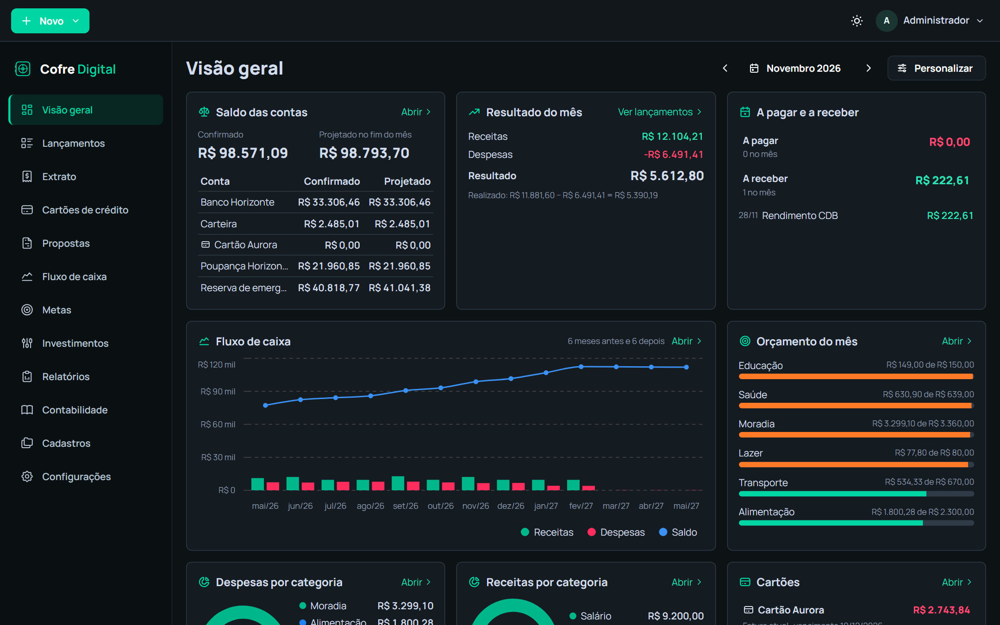

Visão geral: saldos das contas, resultado do mês, fluxo de caixa e orçamento.

<table>
  <tr>
    <td width="50%">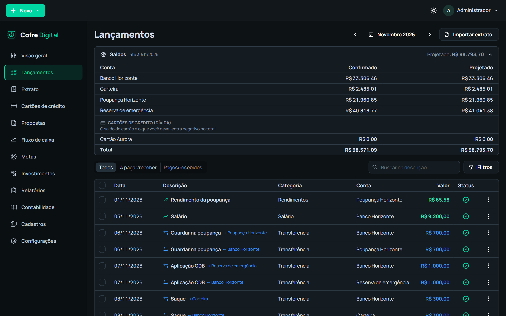 <b>Lançamentos</b> com saldos por conta e transferências ligadas.</td>
    <td width="50%">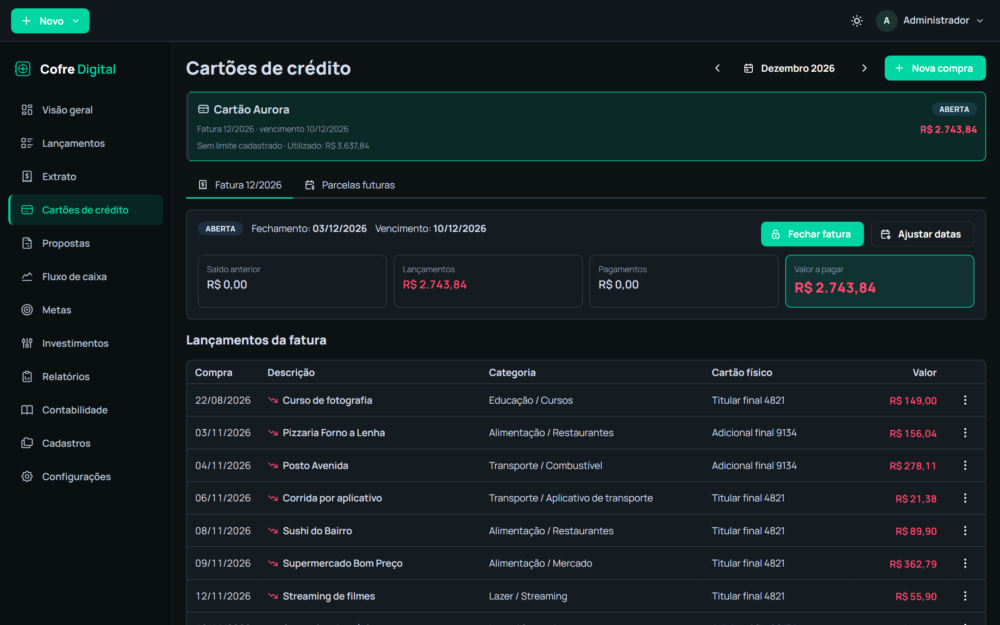 <b>Cartões de crédito</b>: fatura, parcelas e cartões físicos.</td>
  </tr>
  <tr>
    <td width="50%">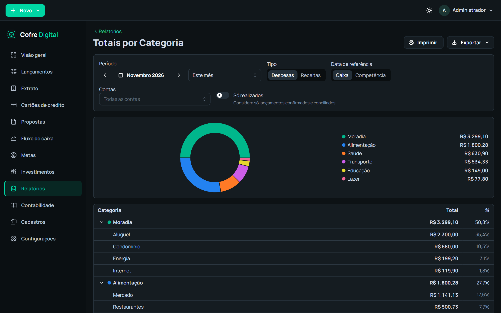 <b>Relatórios</b>: despesas por categoria e subcategoria.</td>
    <td width="50%">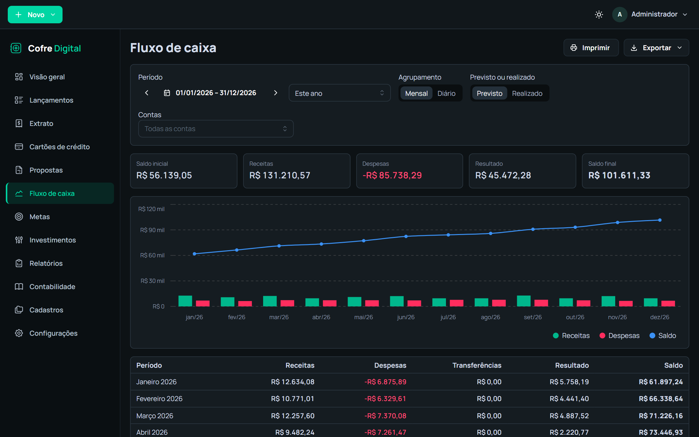 <b>Fluxo de caixa</b> mês a mês, com o que ainda vai vencer.</td>
  </tr>
  <tr>
    <td width="50%">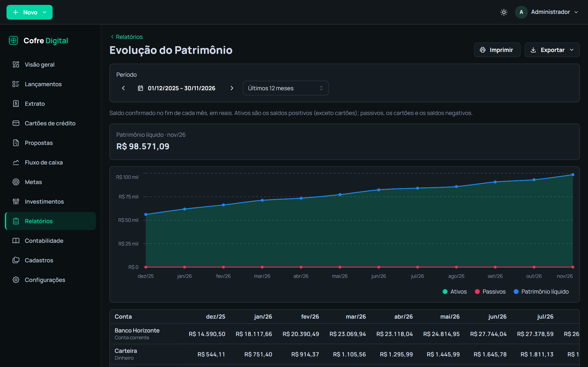 <b>Evolução do patrimônio</b> ao longo do tempo.</td>
    <td width="50%">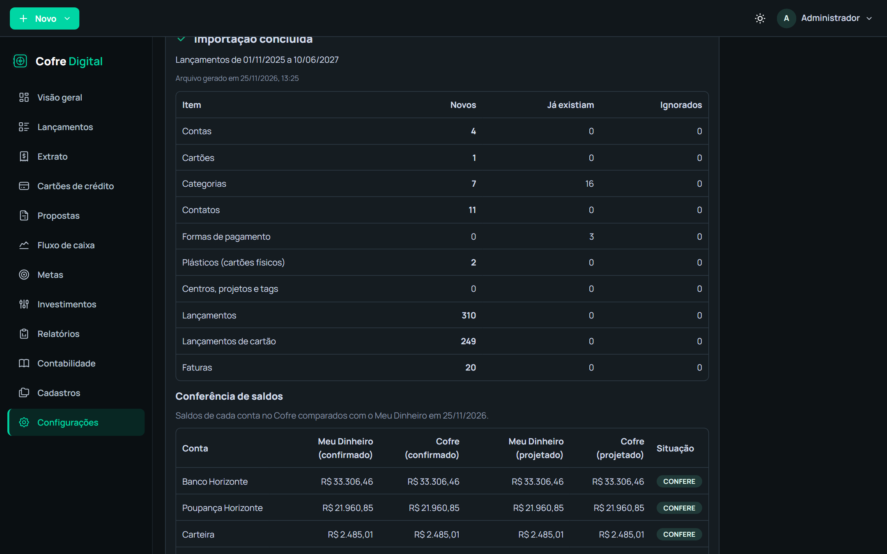 <b>Migrar do Meu Dinheiro</b>, com a conferência de saldos.</td>
  </tr>
  <tr>
    <td width="50%">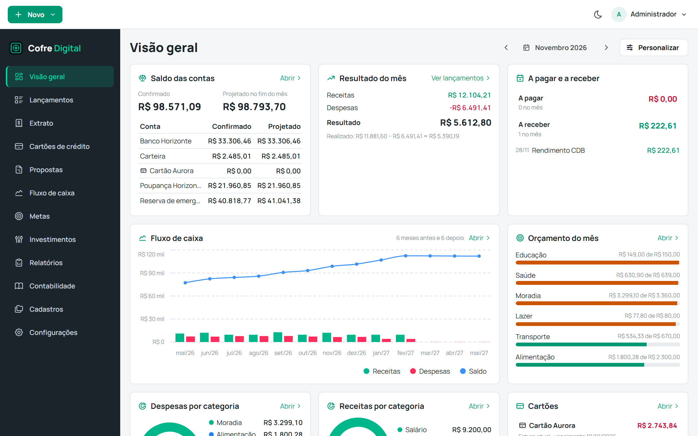 <b>Tema claro</b>.</td>
    <td width="50%">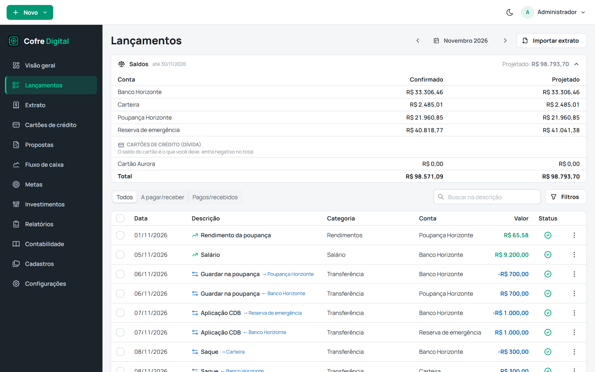 Lançamentos no tema claro.</td>
  </tr>
  <tr>
    <td width="50%">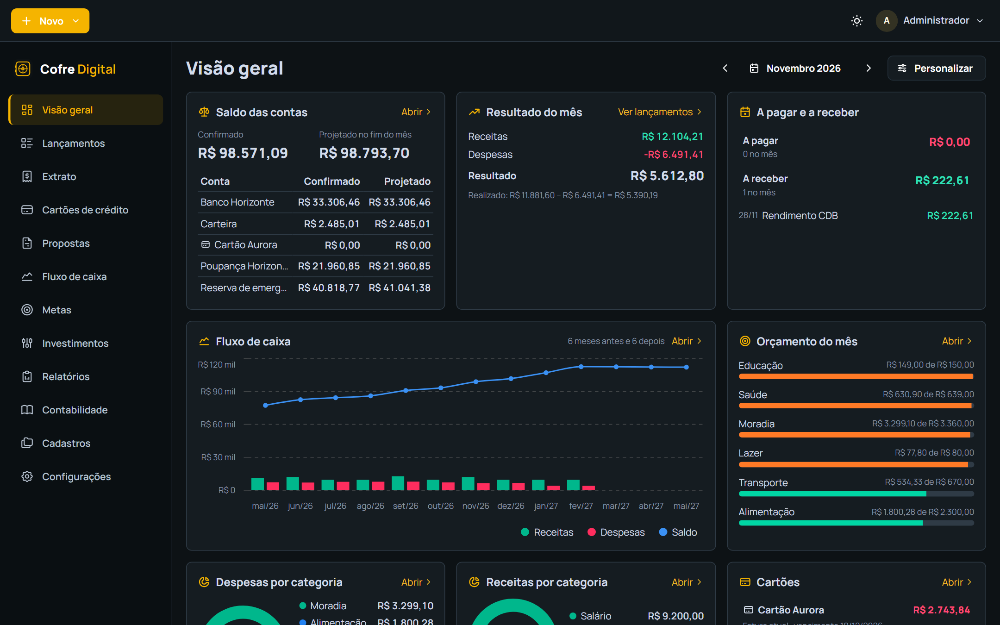 Perfil de cores <b>Homem de Ferro</b>.</td>
    <td width="50%">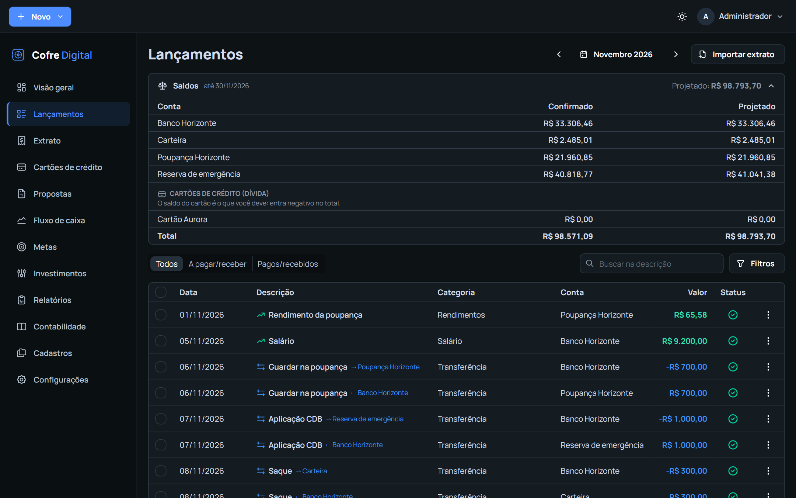 Perfil de cores <b>Capitão América</b>.</td>
  </tr>
</table>

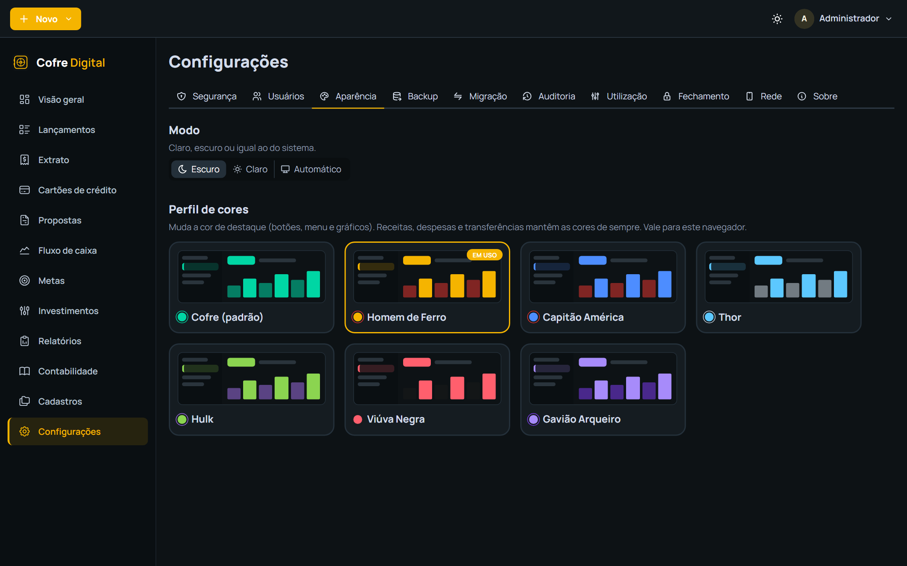

<b>Aparência</b>: modo escuro, claro ou automático e sete perfis de cores.

  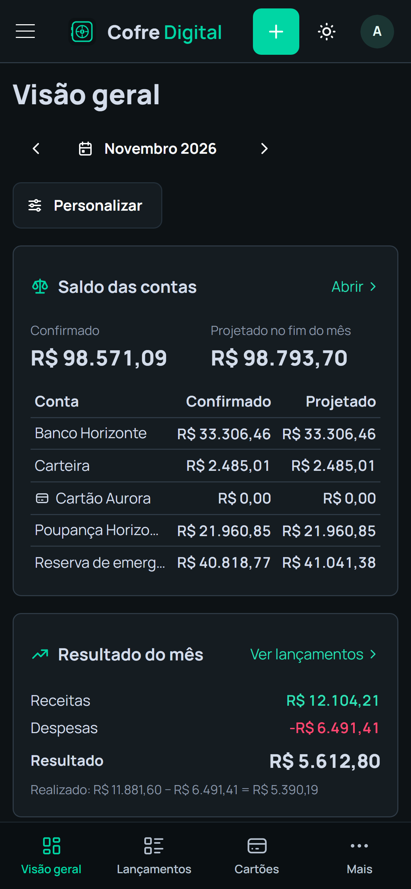
  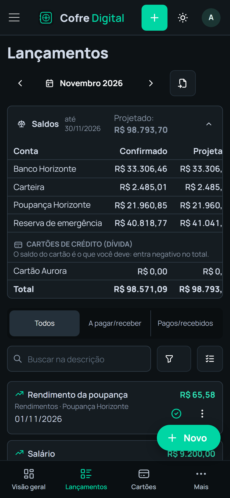
  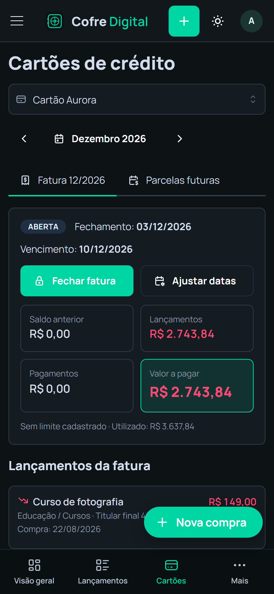

No celular, como app instalável.

Todas as imagens usam dados fictícios.

## Instalar

### 💻 No PC (Windows 10 ou 11, 64 bits)

1. Abra a [versão mais nova](../../releases/latest) e baixe `CofreDigital-<versão>-windows-x64-portable.zip`.
2. Extraia numa pasta sua (Documentos, outra unidade ou pendrive). Evite pastas sincronizadas (OneDrive, Google Drive, Dropbox): sincronizar o banco aberto pode corrompê-lo.
3. Abra `CofreDigital.exe`. O Cofre abre no navegador e fica com um ícone ao lado do relógio.
4. No primeiro acesso, entre com `admin` / `admin`. O app pede uma senha nova e mostra a **chave de recuperação**: guarde-a fora do computador. Sem a senha e sem a chave, ninguém consegue recuperar os dados.

> O executável ainda não tem assinatura de código. Se o Windows mostrar "O Windows protegeu o computador", clique em **Mais informações › Executar assim mesmo**.

### 📱 No celular

Em **Configurações › Rede**, ligue "Acesso pela rede de casa". A tela mostra o endereço com QR code e o passo a passo; depois, no celular, use **Instalar app** ou **Adicionar à Tela de Início**.

### 🐳 Num servidor (VPS Linux)

O mesmo Cofre roda com Docker numa VPS, atrás do Cloudflare Tunnel, sem nenhuma porta aberta. Cada versão traz a imagem `ghcr.io/vicentenetwork-sys/cofre-digital`, o `docker-compose.yml`, o `env.exemplo` e o `GUIA-CLOUDFLARE.md` com o passo a passo. Também há o binário avulso para Linux x64 e arm64.

## Segurança e atualizações

- **Criptografia:** o banco de dados, os anexos e os backups são cifrados; só abrem com a sua senha ou com a chave de recuperação.
- **Atualização segura:** o Cofre avisa quando há versão nova (Configurações › Sobre), baixa, confere a assinatura digital (minisign/Ed25519) e reinicia. Se a versão nova não subir, ele volta sozinho para a anterior. Sem internet, tudo continua funcionando.
- **Conferência manual:** cada versão traz `SHA256SUMS.txt` com o SHA-256 de todos os arquivos, e o `latest.json.minisig`. Veja [todas as versões](../../releases).

---

Este repositório tem só as versões publicadas; o código-fonte não é público. © vicentenetwork-sys. Todos os direitos reservados.
